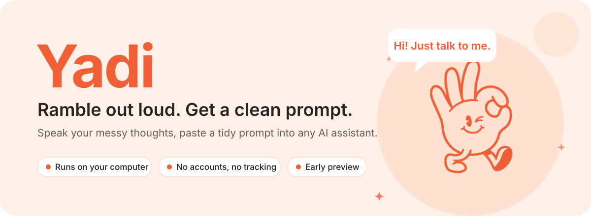
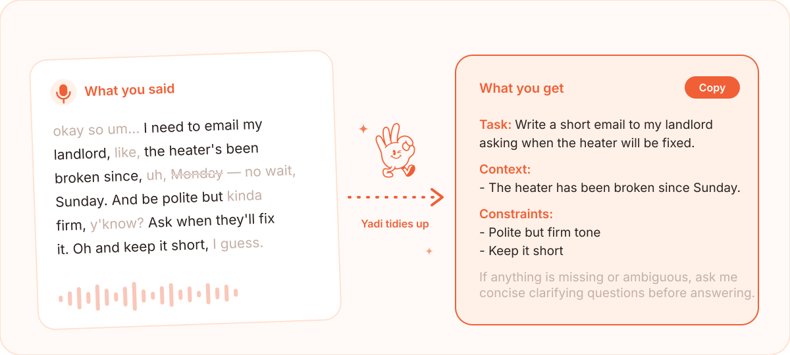

<p align="center">
  
</p>

<p align="center">
  <a href="#-meet-yadi">Meet Yadi</a> ·
  <a href="#-early-days-an-honest-status">Status</a> ·
  <a href="#-why-its-safe-to-use">Privacy</a> ·
  <a href="#-try-it">Try it</a> ·
  <a href="#-troubleshooting">Help</a>
</p>

## 👋 Meet Yadi

Hi, this is Yadi: a little orange hand that waves at you from the edge of your screen.

Hold **Y**, say what you need the way it comes out (ums, restarts, "no wait" and all), and Yadi
hands you back a clean, structured prompt to paste into any AI assistant. Speech recognition and
the language model both run **on your own computer**, so after a one-time setup Yadi works offline.

## ✨ From blabbing to a real prompt

<p align="center">
  
</p>

Yadi drops the filler, keeps only the final version of what you corrected and sorts what you said
into **Task**, **Context**, **Constraints** and **Output**. Only the parts you need show up: a
simple request stays one plain sentence, and Yadi asks the assistant to check with you only when
something seems to be missing. Under each text you'll see a rough token count, and a little
confetti when the prompt came out shorter than what you said.

The model never runs your prompt. It only picks out what you said, and every detail needs a
quote from you as evidence. Plain code then lays the prompt out. That way Yadi can't invent
requirements you never mentioned.

## 🌱 Early days: an honest status

Yadi is at **version 0.1.1**, still its first steps. Please treat it as an early preview:

- **Only tested on macOS** (Apple Silicon). The Windows code is in the project but has not been
  tried on a real Windows PC yet.
- **Testing so far covers the basics:** setup, recording, the transcript, making the prompt and
  copying it. Long sessions, unusual hardware and edge cases have had little attention.
- **The models will get better.** A few small models have been scored on a 44-case test set, and
  more tuning, more models and better prompts are on the way.
- **The installers aren't signed yet,** so macOS and Windows warn you the first time you open
  Yadi. [Try it](#-try-it) shows how to get past the warning.

Much more is coming. If something breaks or feels off, an issue is very welcome.

## 🧠 Your computer picks the model

Yadi looks at your computer (memory, graphics card and free disk space) and picks the biggest
language model that will run comfortably on it:

| Your computer                              | Language model         | Download |
| ------------------------------------------ | ---------------------- | -------- |
| 8 GB of memory (6 GB minimum)              | IBM Granite 4 Micro 3B | ~2.1 GB  |
| 16 GB of memory                            | Qwen3 4B Instruct      | ~2.5 GB  |
| 32 GB of memory, or a 12 GB+ graphics card | Qwen3 8B               | ~5.2 GB  |

**Your results depend on that model.** A bigger model understands long or tangled rambles better.
A smaller one is faster but may miss more. You can switch model in Settings; Yadi warns you if one
is too big for your computer. How each model scored is in
[`eval/results/SUMMARY.md`](eval/results/SUMMARY.md), and the full list is in
[`models.json`](app/src-tauri/resources/models.json).

## 🔒 Why it's safe to use

Your voice and your words never leave your computer. Here's how:

- **Everything runs locally.** Speech recognition and the language model run on your computer. In
  normal use the only connection Yadi makes is to Ollama on your own machine (`127.0.0.1`).
- **Nothing is kept.** Audio only lives in memory while you record and is dropped as soon as the
  transcript is done. Transcripts, prompts and attachments are never saved to disk and never
  written to logs (tests check this). The only things saved are your settings, the words you
  ask Yadi to remember, and a running count of the tokens Yadi saved you (numbers only, never
  your words).
- **No accounts, no telemetry, no analytics.** Yadi doesn't know who you are and doesn't want to.
- **Locked-down window.** The app's content-security policy blocks every outside connection.
- **Checked downloads.** Every speech model is verified against a known SHA-256 fingerprint. The
  Ollama installer's code signature is checked before it runs, and deleted if it doesn't match.
- **Attachments are just data.** Files you drop in are read into memory, never run, and text inside
  them can't change what Yadi writes.
- **You say when it goes online.** Nothing is downloaded before you agree in setup, and updates are
  only checked when you press the button.

<details>
<summary>Exactly what touches the network</summary>

- **Setup:** speech models from `github.com`, the Ollama installer from `ollama.com`, and the
  language model, which Ollama pulls from its own library.
- **Settings > Check for updates:** reads Yadi's public release information from `api.github.com`
  and downloads a new installer from `github.com` only when you press the button. The installer is
  checked against the SHA-256 fingerprint GitHub publishes for it. Nothing about you is sent, and
  nothing is checked in the background.

That's all. The window's content-security policy and the app's HTTP permission list stop the
interface from reaching anything except Ollama on `127.0.0.1`. The downloads above are made by
Yadi's own code, which only fetches from those addresses.

</details>

## 🚀 Try it

### Download

| Your computer         | Download                                                                                                           |
| --------------------- | ------------------------------------------------------------------------------------------------------------------ |
| macOS (Apple Silicon) | [Yadi_0.1.1_aarch64.dmg](https://github.com/elara-studio/Yadi/releases/latest/download/Yadi_0.1.1_aarch64.dmg)     |
| Windows (x64)         | [Yadi_0.1.1_x64-setup.exe](https://github.com/elara-studio/Yadi/releases/latest/download/Yadi_0.1.1_x64-setup.exe) |

All versions and release notes are on the [Releases page](https://github.com/elara-studio/Yadi/releases/latest).

**The installers aren't signed yet**, so your computer will warn you the first time:

- **macOS:** open the DMG and drag Yadi to Applications. Open Yadi; when macOS says it can't be
  opened, go to **System Settings → Privacy & Security**, scroll down and click **Open Anyway**.
- **Windows:** if SmartScreen says "Windows protected your PC", click **More info → Run anyway**.

### Run from source

```sh
pnpm install
pnpm dev          # runs the app in development mode
pnpm build        # builds the installer (a .dmg on macOS, an NSIS .exe on Windows)
```

You need Node 20+, pnpm, Rust (stable) and the Xcode Command Line Tools on macOS. On Windows you
need the MSVC build tools and WebView2.

### First run

The first time Yadi starts, it walks you through a short setup:

1. **Welcome:** shows your computer (memory, graphics, free disk), the models Yadi picked and how
   much it will download, then asks for your OK. Nothing is downloaded before you agree.
2. **Ollama:** the local engine that runs the language model. If it isn't installed, Yadi can
   download the official installer, check its signature and install it, with your consent.
3. **Models:** the language model for your computer (about 2 to 5 GB) and two small speech
   models. Downloads pick up where they left off if interrupted.
4. **Microphone and keyboard permissions** (on macOS, Hold-Y needs Accessibility).
5. **Done:** choose whether Yadi starts when you log in (ticked by default). You can re-run or
   repair setup any time from Settings.

You'll need roughly 4 to 5 GB of free space on a typical computer, more for the biggest model.

## 🎙️ Using Yadi

| Do this                          | What happens                                                                                                     |
| -------------------------------- | ---------------------------------------------------------------------------------------------------------------- |
| **Hold the Y key** (about 0.4 s) | Yadi opens, from any app. A quick tap still types "y".                                                           |
| **Y** (in the Yadi window)       | Starts recording; press **Y** again to stop and make the prompt.                                                 |
| **Esc**                          | Stops what is happening. Esc again hides the window.                                                             |
| **Double-click a word**          | Fix it. The pencil edits the whole transcript. Yadi offers to remember the word.                                 |
| **Drop or paste files or text**  | Adds attachments (text, code, PDF, Word). Yadi uses their start to understand the topic and never rewrites them. |
| **Copy** (or press **C**)        | Copies the prompt. **Copy with attachment text** adds the attachments' contents.                                 |
| **Drag the prompt**              | Drops it straight into another app.                                                                              |

Yadi the mascot always stays on screen: click it to open or hide the chat, or drag it where you
like. The menu-bar icon has Show/Hide, About and Quit. If holding Y doesn't suit your computer, pick
a shortcut such as **Cmd/Ctrl+Shift+Y** in Settings.

Even after you quit Yadi, holding Y (or your shortcut) opens it again. Once setup is finished, a
small listener with no window, microphone or model starts at login for this. It stays idle while
Yadi is running.

**Settings** has the hold time (250 to 900 ms, with a test), shortcut, microphone, language model,
polishing the transcript after recording, start at login, mascot animations, your own words (names
and jargon), re-run or repair setup, licences, check for updates and a reset.

## 🛟 Troubleshooting

- **Holding Y does nothing (macOS).** Yadi needs _Accessibility_ permission to see the held key.
  Open System Settings > Privacy & Security > Accessibility and switch Yadi on; Hold-Y starts
  within a few seconds. Until then your shortcut works instead (Cmd+Shift+Y unless you changed
  it).
- **No sound level / "microphone denied".** System Settings > Privacy & Security > Microphone:
  switch Yadi on. On Windows: Settings > Privacy > Microphone.
- **Antivirus warns about Yadi (Windows).** The Hold-Y feature uses a keyboard hook, which some
  antivirus programs flag. Choose a shortcut in Settings instead (no hook is used then) and, if you
  trust the build, allow Yadi in your antivirus.
- **"Could not reach the language model".** Yadi starts Ollama for you. If it still fails, open the
  Ollama app yourself, or check that nothing else uses port 11434.
- **"The language model is not installed".** Use "Open setup to install it" in the message, or
  Settings > Repair models.
- **The first prompt is slow.** The model is loading into memory; later prompts are faster. A
  smaller model (Settings) is faster still.
- **Something else.** Run the app from a terminal to see its log. The log never contains your
  words, only events and errors.

## 🛠️ Development

Built with Tauri 2 (Rust), React, TypeScript, Vite and a pnpm workspace.

```sh
pnpm test         # vitest (all packages), script tests and cargo test
pnpm lint         # eslint, prettier --check, cargo fmt --check, cargo clippy -D warnings
pnpm typecheck
pnpm check:licenses   # licence data + THIRD_PARTY_NOTICES.txt + compliance checks
pnpm eval --model <ollama-tag> [--judge <ollama-tag>]   # score a model on eval/cases.jsonl
```

| Path             | What                                                                           |
| ---------------- | ------------------------------------------------------------------------------ |
| `app/`           | Tauri app (React frontend in `src/`, Rust in `src-tauri/`)                     |
| `packages/core/` | Pure TypeScript: state machine, transcript, prompt pipeline, attachments rules |
| `eval/`          | Prompt-quality eval set, scorers and runner                                    |
| `licenses/`      | Hand-written licence manifest for bundled runtimes and models                  |
| `scripts/`       | Licence tooling and test fixtures                                              |

<details>
<summary>Guidelines for contributors</summary>

- The prompt pipeline's last step is **code, not a model**: the model returns structured findings,
  every detail needs a quote of what the person said as evidence, and a template renders the
  prompt. Do not let a model write the final prompt.
- **Privacy is a rule, not a preference:** never log transcripts, audio, prompts or attachment
  text, and never write them to disk. Tests check the redaction helper; reviewers check the rest.
- Add an eval case (`eval/cases.jsonl`, append only) whenever a real input fails. Prompt tuning
  must not look at the hold-out cases (every 4th case).
- Every new dependency must pass `pnpm check:licenses` (allow-list in
  `scripts/lib/licenses.mjs`; extending it needs a human decision).
- Windows behaviour cannot be run on a Mac: keep platform code compiling for both
  (`cargo clippy --target x86_64-pc-windows-msvc`).

</details>

<details>
<summary>Platform notes and releasing</summary>

- **macOS transparency:** the floating windows are transparent, which needs Tauri's
  `macOSPrivateApi` setting. Apps using it cannot be on the Mac App Store; direct distribution is
  unaffected.
- On macOS Yadi runs without a Dock icon (only the mascot and the menu-bar icon).
- Development builds (`pnpm dev`) do not register the login listener that reopens Yadi after
  Quit, unless you set `YADI_SUMMON_LISTENER=1`. They also show licences only after
  `pnpm check:licenses`, and macOS gives permissions to your terminal or editor, not to Yadi.
- Pushing a version tag (`v*`) builds the installers and attaches them to a draft GitHub
  release. They are not signed or notarised yet.

</details>

## 📄 Licence

Application code: Apache-2.0 (see `LICENSE`; a placeholder until the copyright holder confirms).
Bundled and downloaded third-party components, models and runtimes carry their own licences. They
are listed in the app under **About** and in `THIRD_PARTY_NOTICES.txt` inside the installer.

<p align="center">
  <br>
  <br>
  <sub>Thanks for stopping by. Yadi will be at the edge of your screen whenever you need it.</sub>
</p>
